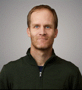

# OM VATTEN
**Om Vatten** is Swedish and means **About Water**.

Water is the home of the microbial communities I like to study in my research. 
Water is a major topic in the courses I teach at Chalmers University of Technology. 
Water is also something I drink occassionally. Hence, *Om Vatten* seemed like a fitting name for this website. 

Here I have collected information about my research, software tools, and teaching. 
The website also contains the Swedish textbook [Om Vatten](https://omvatten.github.io/textbook).

**Oskar Modin**

# Research

Microorganisms drive key processes in wastewater treatment, drinking water production, nutrient cycling, pollutant degradation, resource recovery, and food production, as well as infrastructure deterioration.

My research focuses on microbial ecology in engineered systems. 
I am interested in how microbial communities assemble, evolve, and function, and how microbial interactions shape the performance of technical systems. 
By combining microbial ecology and environmental engineering, I want to improve our understanding and management of water systems and the built environment. 

Check out my [scientific publications](https://scholar.google.com/citations?hl=sv&user=BG6O3hYAAAAJ).

Topics of interest include:
- Community assembly and ecological theory
- Biodiversity and diversity metrics
- Virus-host interactions
- Bioelectrochemical systems
- Wastewater treatment
- Anaerobic digestion
- Methane production and oxidation
- Nutrient removal and recovery

# Software

I develop open-source software for microbial ecology, environmental biotechnology, and education.

## [qdiv](https://github.com/omvatten/qdiv)
A Python package for analyzing microbial community data from amplicon sequencing, metagenomics, and related methods.
This package is activately maintained and we have implemented several new methods for ecological analyses. See the following papers:
- [Modin 2026](https://doi.org/10.21105/joss.10089)
- [Modin et al. 2020](https://doi.org/10.1186/s40168-020-00909-7)
- [Modin and Persson 2026](https://doi.org/10.64898/2026.10.07.757245)

## [pHICsim](https://github.com/omvatten/pHICsim)
This is a streamlit app for calculating pH and inorganic carbon concentration in water and aquaculture systems. 
The website on the streamlit cloud is available [here](https://omvatten-phicsim-phicsim-66n9yv.streamlitapp.com).

## [biops](https://github.com/omvatten/biops)
This is a python package for simulating the performance of biological reactors. For example, activated sludge and biofilm reactors used for wastewater treatment.
The package was originally developed for teaching purposes, but is no longer actively maintained.

# Teaching

[Om Vatten](https://omvatten.github.io/textbook) textbook in Swedish.
The textbook is an introduction to water quality and water technology. 
It is written in Swedish and used as course literature in some of my courses.  

Example datasets used in the textbook Om Vatten and in Python exercises are available [here](https://omvatten.github.io/datasets).
